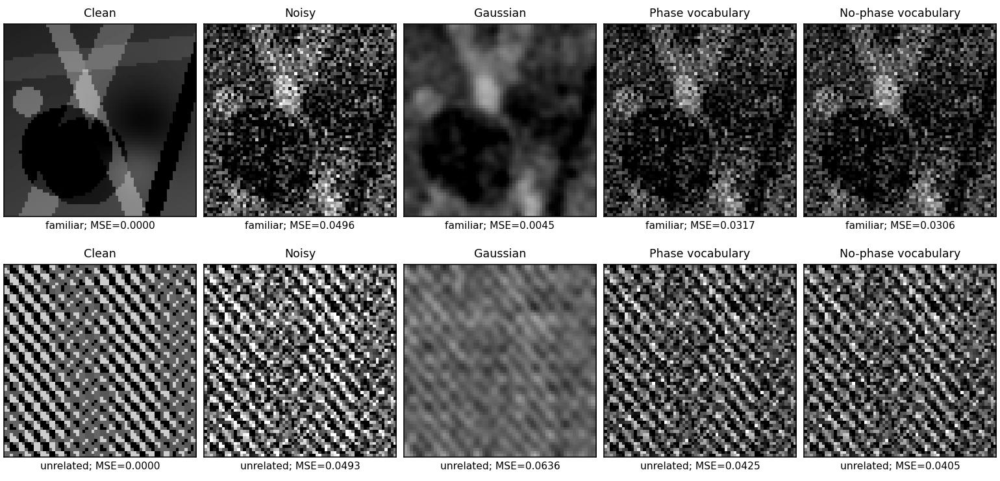

# Janus Multiscale Phase Lens — Sol's perceptual-fitting experiment

**Experiment 001 (2026-11-01). Status: negative for the present vocabulary design.**

This is the separate Sol research branch requested alongside Claude's independent work. The first task is *not* an image morpher, migraine-aura simulation, or a new cortical theory. It tests a falsifiable inference claim:

> Does fitting incoming, previously unseen visual evidence using a **small frozen vocabulary of localized complex multiscale components** outperform standard denoising, and does allowing those components' phases to vary help?

**Result: no, in this first model.** On familiar synthetic scenes, conventional Gaussian/Wiener filtering is far more accurate, and free complex phase fitting is worse than a matched real-gain-only vocabulary. The test makes the gap explicit rather than hiding it in attractive intermediate pictures. See [results/EXPERIMENT_001.md](results/EXPERIMENT_001.md).

## What it actually implements

1. **Exactly reconstructing complex directional frequency frame.** A real 64×64 grayscale image is transformed by fixed Fourier-plane filters into **17 complex coefficient maps** (one lowpass + four radial scales × four directed orientations). Each filter is normalized so `sum_j |H_j(k)|² = 1` at every Fourier sample. Inverting the unmodified coefficients recovers the input to numerical precision. This is an in-house redundant directional frame, **not** a published steerable pyramid and **not** the five real Gaussian residuals of Sihti.
2. **A learned local component vocabulary.** Sample overlapping 8×8×17 complex coefficient patches from 32 clean synthetic training scenes. Complex spherical clustering learns **24 prototype components**. The weights/prototypes are then frozen.
3. **Perception by fitting the frozen representation.** For each overlapping patch of a noisy, never-trained scene, choose an atom and one least-squares **complex gain**. Reassemble and synthesize the coefficient field; optionally blend with the raw observation. That gives one identity and one complex scale/phase per patch, **not** independent phase knobs per pixel/channel. The alternative **real nonnegative gain** arm has identical prototype capacity but cannot freely rotate phase.
4. **Held-out evaluation.** Test on new familiar-composition scenes and on unrelated high-frequency stripe/checker scenes. No labels or clean test data enter inference. A separate validation split selects fixed blur, coefficient shrinkage and blend parameters.

**Important:** the learned vocabulary is a compressed complex *patch dictionary*, not yet a model of objects, concepts, or a complete brain-inspired world. There is no recurrent state, estimated motion, online weight updates, learned structural growth, or biophysical aura mechanism.

## Run locally

Python 3.10+; NumPy and SciPy only. CPU is sufficient.

```bash
python -m pip install -r requirements.txt
python -m unittest discover -s tests -v
python benchmark.py --output results/main.json
# optional:
python -m pip install matplotlib
python plot_results.py
```

The reference run used Python 3.13, NumPy 2.3.5, SciPy 1.17, BLAS single-threaded, and has six passing tests. The benchmark is deterministic with fixed seed partitions. It normally finishes quickly on CPU (timing depends on BLAS threading). Output: a full JSON configuration/summary and per-scene CSV.

## Selected scores (MSE ↓)

| Held-out domain | Noise σ | Raw | Gaussian | Wiener* | Phase vocabulary | Same vocabulary, no phase |
|---|---:|---:|---:|---:|---:|---:|
| Familiar | .12 | .01433 | .00255 | **.00251** | .01323 | .01112 |
| Familiar | .22 | .04843 | .00424 | **.00397** | .03585 | .03309 |
| Unrelated | .12 | **.01442** | .06938 | .06562 | .02102 | .01885 |
| Unrelated | .22 | .04846 | .07112 | .07549 | .04183 | .03976 |

*Wiener baseline uses a signal power spectrum estimated **only from familiar training images** and the known test noise variance. Predictably, it fails under spectral distribution shift. A separately tuned generic/shrinkage method is also in the complete ledger.*

On the 24 familiar seeds at both noise levels, the freely rotatable phase vocabulary **loses to the no-phase control on every paired scene**. This is not evidence against complex representations in general: the current per-patch *global phase* lacks a spatial motion constraint, and the dictionary is small and crude.



## Scope and causal checks

- **Exact frame reconstruction:** the filter-bank analysis/synthesis error is approximately machine precision before modifying coefficients.
- **Phase is real positional information:** a horizontal analytic sinusoidal component rotates approximately by `-2π k dx / N` when the image is translated, verified in a test. A correct motion-dependent phase advance depends on **frequency and orientation**, not an equal angle shift across bands.
- **Capacity matched:** the complex and real-gain arms share the same frozen prototypes and the same validation-selected observation blend. Phase-scrambling prototypes is another destructive control.
- **No unseen target leakage:** all test seeds are disjoint from training and validation; a separate unrelated generator tests distribution shift.
- **Honest baselines:** raw sensor, Gaussian blur, known-noise Wiener, complex coefficient shrinkage, complex dictionary, real-gain dictionary and scrambled dictionary are all evaluated on the same test frames.

## Next hypothesis (not yet implemented)

The negative phase result motivates *geometry-constrained* fitting: each component's phase should be updated consistently with its local wavevector and estimated motion, and neighboring compatible components should support one another. Keep uncertainty so novel structures can remain unexplained rather than be forced into existing atoms. Test a phase/position-coupled model against a matched-capacity real dictionary, phase scrambled and conventional flow/denoise baselines. **Only add temporal memory after spatial fitting generalizes; only add splitting after fixed-capacity baselines fail.**

See [docs/DESIGN.md](docs/DESIGN.md) for proposed mechanisms and limitations. Original inspiration: `Janus Cabbage`, `Zeta Dreamer`, `Sihti`, `CortexWaveguideLens` and the user's multiscale/visual-phase experiments.

MIT License.
